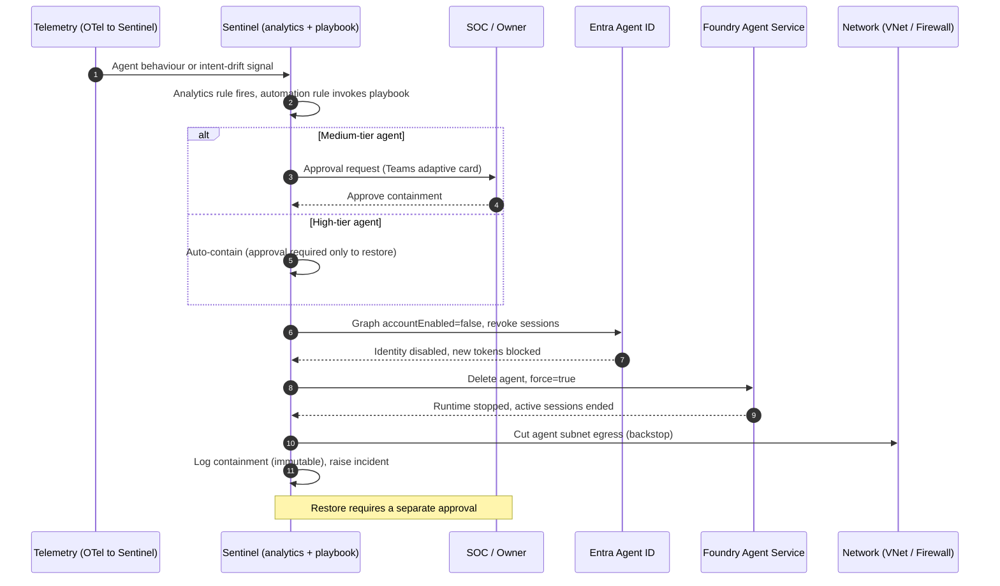
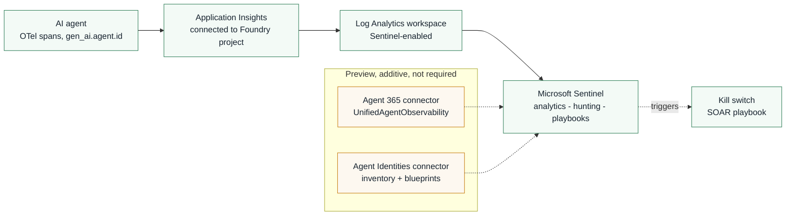
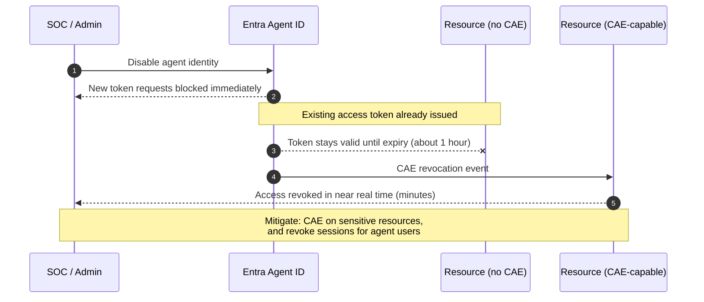
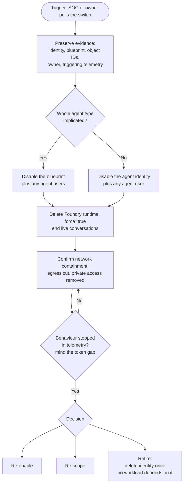
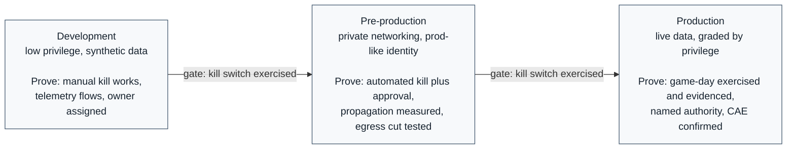
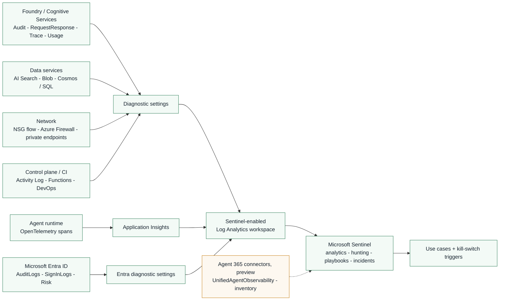
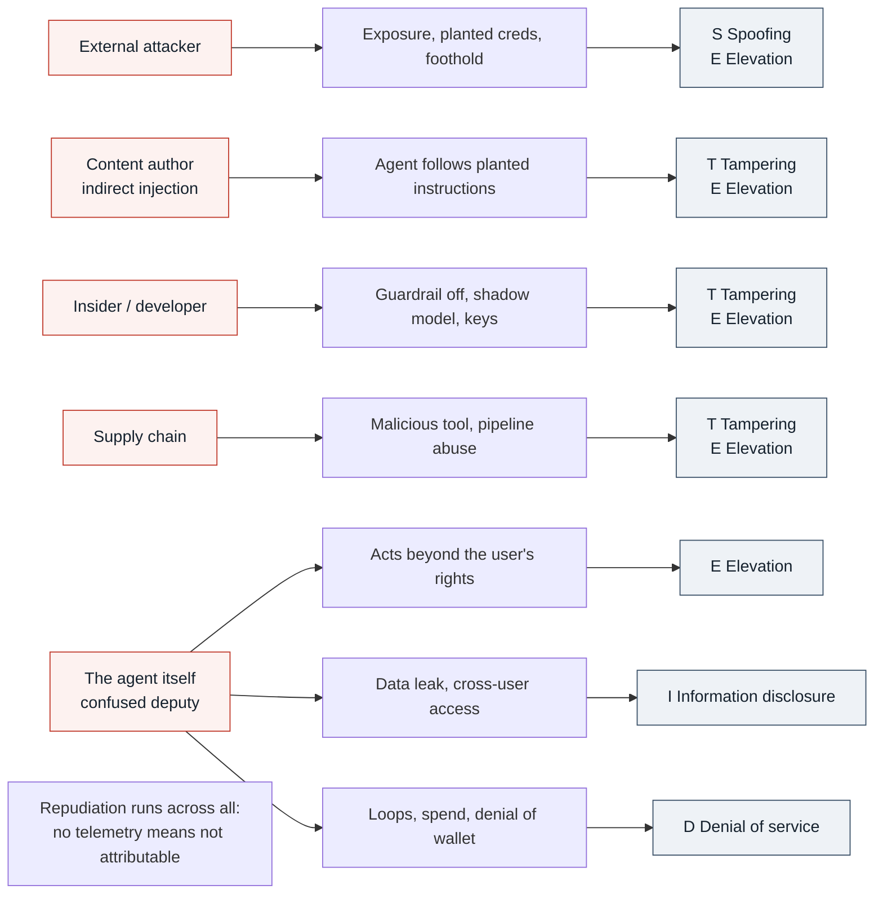

# All diagrams, mermaid source

Every diagram across the kill switch fact file and the SOC enablement pack, as
editable mermaid. These render natively on GitHub, in VS Code with a mermaid
extension, and in any mermaid viewer. Paste a block into a markdown file to
render it. Line breaks use ` `; dashed arrows mean preview or return.

Contents:
1. Kill switch, the SOAR sequence  (kill switch fact file)
2. Telemetry path to Sentinel  (kill switch fact file)
3. The token-propagation gap  (kill switch fact file)
4. Manual kill runbook  (kill switch fact file)
5. Licence to operate, stage gates  (kill switch fact file)
6. SOC log flow, all sources to Sentinel  (SOC pack)
7. The kill switch, logical buttons by plane  (SOC pack)
8. Threat actors, threats and STRIDE  (SOC pack)

---

## Diagram 1. Kill switch, the SOAR sequence
Source: kill switch fact file, section 10. What it shows: the automated path, a
Sentinel analytic fires a playbook that disables the identity, deletes the
runtime and cuts egress, with an approval gate graded by tier.

---

## Diagram 2. Telemetry path to Sentinel
Source: kill switch fact file, section 9. What it shows: the OpenTelemetry route
is generally available and connector-independent. The preview connectors add
inventory and identity context on top.

---

## Diagram 3. The token-propagation gap
Source: kill switch fact file, section 2.1. What it shows: disabling blocks new
tokens at once, but an already-issued token survives up to its lifetime unless
the resource supports Continuous Access Evaluation.

---

## Diagram 4. Manual kill runbook
Source: kill switch fact file, section 10. What it shows: the manual fallback and
platform-level path, from evidence capture to the decision to re-enable, re-scope
or retire.

---

## Diagram 5. Licence to operate, stage gates
Source: kill switch fact file, section 3. What it shows: the dev to pre-production
to production progression, with the kill switch exercised before each promotion.

---

## Diagram 6. SOC log flow, all sources to Sentinel
Source: SOC pack, section 3. What it shows: every Azure resource in scope routing
into one Sentinel-enabled workspace through diagnostic settings, the App Insights
link and Entra diagnostic settings, with the preview connectors added on top.

---

## Diagram 7. The kill switch, logical buttons by plane
Source: SOC pack, section 5. What it shows: the kill switch is a set of logical
controls across five planes. Red = the core single-agent kill (disable identity,
delete runtime, cut egress); the rest are graded or situational.

```mermaid
flowchart TB
    subgraph ID["Identity plane"]
      direction TB
      I1["Disable agent identity<br/>new tokens blocked"]:::red
      I2["Disable blueprint<br/>all of that type"]:::red
      I3["Disable agent user"]
      I4["Revoke sessions<br/>close the token gap"]
      I5["CA block, tenant<br/>all agent auth"]
      I6["Remove role assignments<br/>block new agents"]
    end
    subgraph RT["Runtime plane"]
      direction TB
      R1["Delete agent, force<br/>ends active sessions"]:::red
      R2["Delete agent version"]
      R3["Delete conversation"]
      R4["Pause deployment"]
    end
    subgraph NET["Network plane"]
      direction TB
      N1["Cut egress, firewall<br/>deny agent subnet"]:::red
      N2["NSG deny rule"]
      N3["Remove private endpoint"]
    end
    subgraph DATA["Data plane"]
      direction TB
      D1["Rotate / revoke keys"]
      D2["Revoke data connection"]
      D3["Purview DLP block"]
    end
    subgraph PLAT["Platform plane"]
      direction TB
      P1["Disable project"]
      P2["Disable guardrail bypass"]
      P3["Disable public access"]
    end

    classDef red fill:#fdf2f0,stroke:#c0392b,color:#c0392b,font-weight:bold;
```

---

## Diagram 8. Threat actors, threats and STRIDE
Source: SOC pack, section 6. What it shows: the five actor types mapped to the
threats they create and the STRIDE categories. Repudiation underpins all of them,
it is the case for the logging itself.

---

### Notes on rendering and editing
- These use ` ` for line breaks, which GitHub's mermaid renderer handles.
  Some older viewers prefer `\n`; swap if a line break shows literally.
- Diagram 7 uses `:::red` on the core-kill buttons and a `classDef`. If a viewer
  does not support inline class syntax, move the class to a `class I1,I2,... red;`
  line at the end of the block.
- Colours are set with `classDef`. Remove the `classDef` and `class` lines for a
  plain black-and-white render.
- To export an image from any of these, use the GitHub preview, or VS Code with a
  mermaid extension, or a local mermaid CLI with a browser available.
